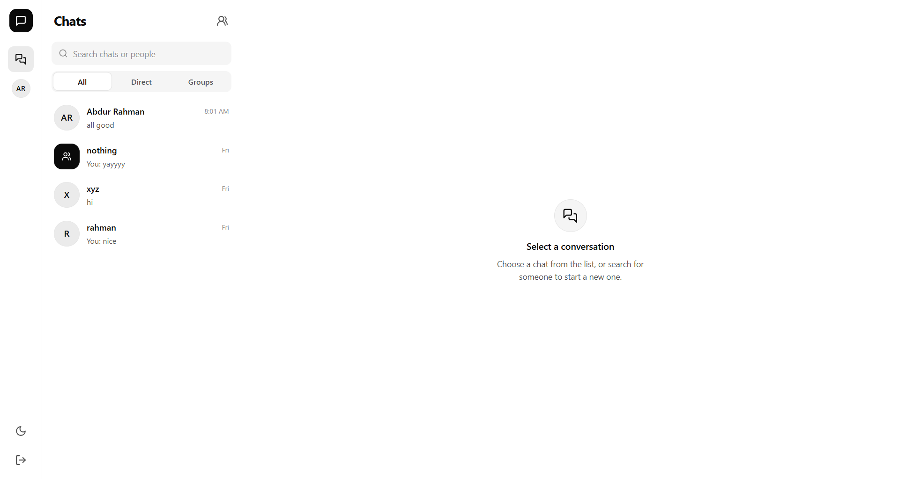
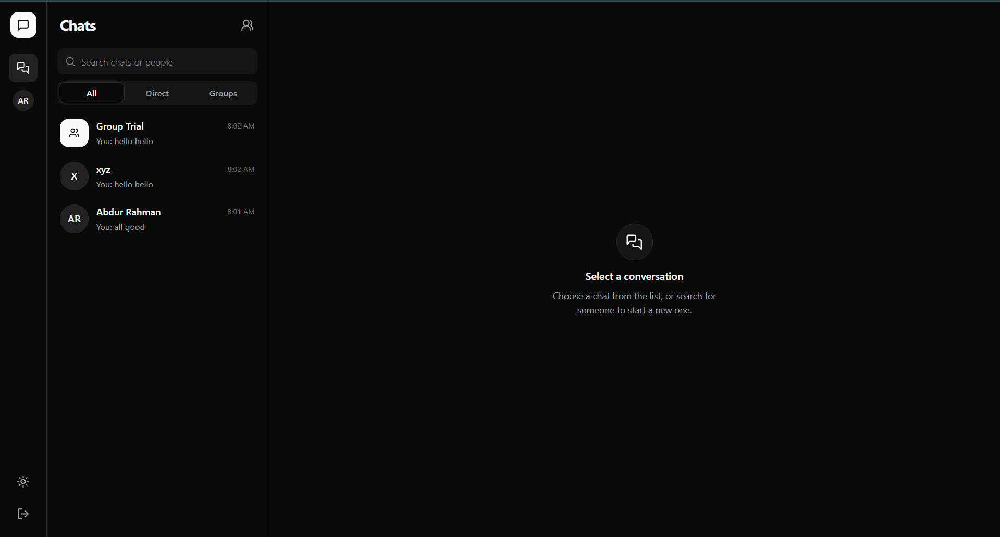
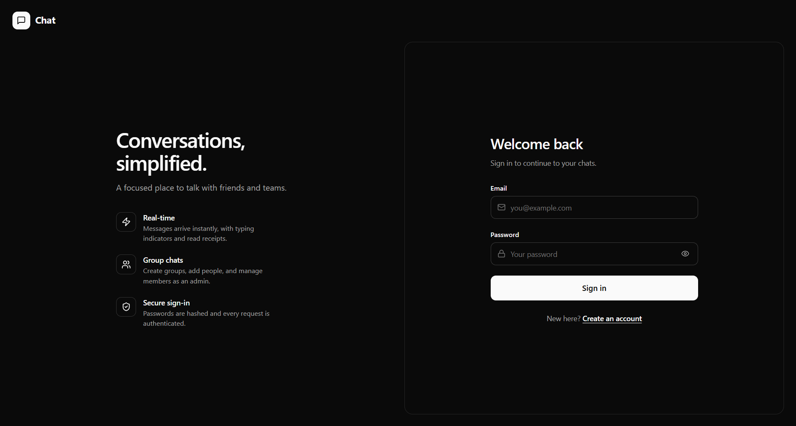
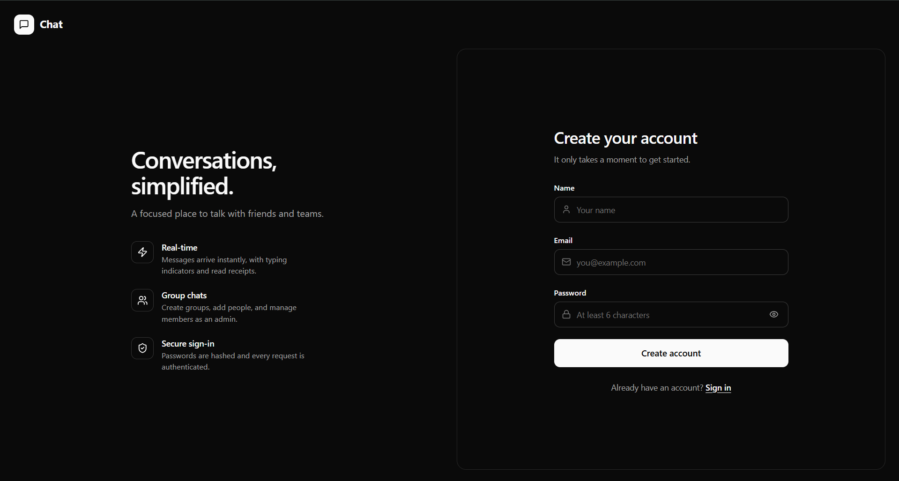
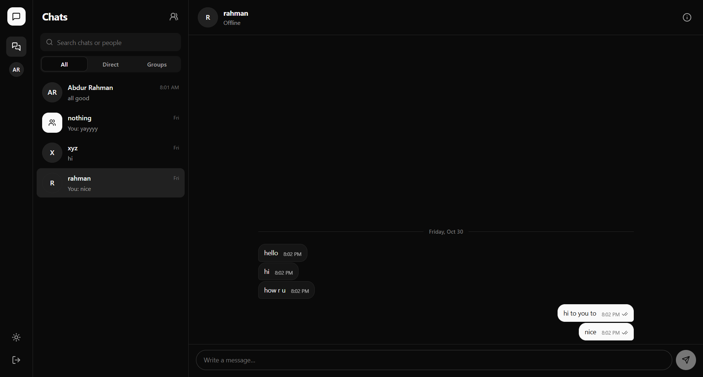
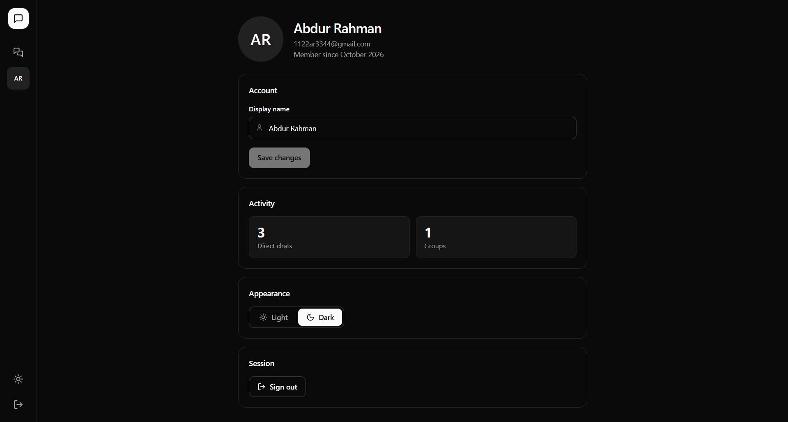
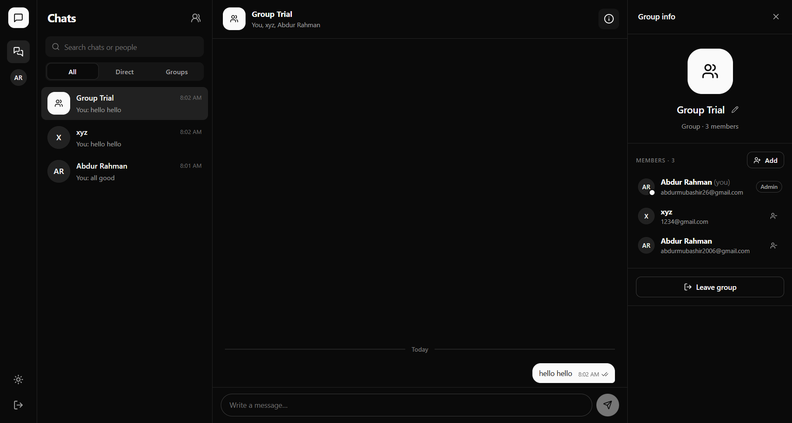

# 💬 MERN Realtime Chat Application

A full-stack real-time messaging platform built using the **MERN Stack + Socket.IO**, allowing users to communicate through **private chats and group conversations** with live messaging, notifications, typing indicators, delivery status, and authentication.

### 🏠 Chat Main Light



---

## ✨ Features

### 👤 Authentication

* User Registration & Login
* JWT-based Authentication
* Protected Routes
* Persistent User Sessions
* Logout System

### 💬 Private Chat System

* One-to-One Messaging
* Search Users
* Create New Conversations
* Realtime Message Delivery
* Message History Storage

### 👥 Group Chat System

* Create Groups
* Add Users to Groups
* Leave Groups
* Group Member Management
* Group Information Panel

### ⚡ Realtime Features

* Socket.IO Realtime Messaging
* Live Message Updates
* Typing Indicator
* Online User Tracking
* Realtime Chat Sidebar Updates
* Instant Notifications

### 📩 Message System

* Send Messages
* Message History
* Delivery Status (✓✓)
* Seen Status
* Delete Message For Everyone
* Timestamp Support

### 🔔 Notifications

* Unread Message Count
* Notification Badge System
* Realtime Notification Updates
* Per-Chat Unread Tracking

### 🎨 UI Features

* Modular Chat UI
* Sidebar Layout
* Chat Header
* Message Bubbles
* User Avatars
* Search Components
* Loading Indicators
* Modal System
* Profile Page

---

## 🛠️ Tech Stack

### Frontend

* React.js
* React Router DOM
* Context API
* Socket.IO Client
* Tailwind CSS

### Backend

* Node.js
* Express.js
* Socket.IO
* JWT Authentication
* REST APIs

### Database

* MongoDB
* Mongoose ODM

### Deployment

* Frontend: Vercel / Netlify
* Backend: Render
* Database: MongoDB Atlas

---

## 📂 Project Structure

```bash
chat-app/
├── backend/
│   │
│   ├── src/
│   │   ├── config/
│   │   ├── controllers/
│   │   ├── middleware/
│   │   ├── models/
│   │   ├── routes/
│   │   ├── socket/
│   │   ├── app.js
│   │   └── server.js
│   └── .env
│
├── frontend/
│   ├── src/
│   │   ├── api/
│   │   ├── assets/
│   │   ├── components/
│   │   │   ├── chat/
│   │   │   ├── group/
│   │   │   ├── common/
│   │   │   └── notifications/
│   │   ├── context/
│   │   ├── api/
│   │   ├── pages/
│   │   │   ├── auth/
│   │   │   ├── chat/
│   │   │   └── profile/
│   │   ├── routes/
│   │   ├── socket/
│   │   ├── styles/
│   │   │   ├── components/
│   │   │   └── pages/
│   │   ├── utils/
│   │   ├── App.jsx
│   │   └── main.jsx
│   └── package.json
│
└── README.md
```

---

## ⚙️ Environment Variables

Create a `.env` file inside **backend/**

```bash
MONGO_URI=mongodb://127.0.0.1:27017/chat-app

JWT_SECRET=your_super_secret_key

PORT=5000

NODE_ENV=development
```

---

## 🧪 How to Run Locally

### 🔧 Backend

```bash
cd backend

npm install

npm run dev
```

### 🌐 Frontend

```bash
cd frontend

npm install

npm run dev
```

---

## 📸 Screenshots

### 🏠 Chat Main



###  🔐 Login



### 🔏 Register



### 💬 Message



### 👤 Profile Page



### 👥 Group Chat



---

## 🔮 Future Improvements

* Message Reactions
* Message Editing
* Voice Messages
* File Upload Support
* Emoji Picker
* Video / Voice Calling
* Dark Mode
* Push Notifications
* Mobile Responsive Layout
* End-to-End Encryption

---

## 🧠 What I Learned

* MERN Stack Architecture
* JWT Authentication
* REST API Design
* Socket.IO Realtime Communication
* MongoDB Schema Design
* Context API State Management
* Protected Routing
* Reusable Component Architecture
* Debugging Full-Stack Applications
* Deployment (Render + Vercel)

---

## 📬 Contact

If you like this project or want to collaborate:

* GitHub: https://github.com/abdurrah0006
* Linkedin: https://linkedin.com/in/abdurrah0006

---

## ⭐ Give a Star

If you found this project useful, consider giving the repository a ⭐
